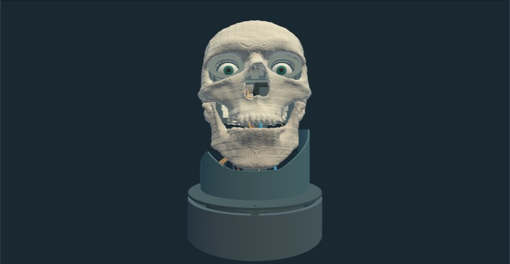

# R5 로봇 헤드

R5는 코에 달린 USB 카메라로 얼굴을 검출해 사람의 두 눈 사이를 따라보는 해골 로봇 헤드입니다. PC가 카메라 영상을 처리하고, OpenRB-150이 눈 좌우·상하, 눈꺼풀, 목 좌우·상하, 턱의 여섯 축을 구동합니다. ESP32-C3 기판은 2.4 GHz 안테나 실험용입니다.

B18 목 가림막 시안입니다. [CAD 개정 이력](mechanical/revisions/) · [모델과 자료 출처](web/README.md#모델과-자료-출처)

## 디렉터리 구성

- [mechanical/](mechanical/README.md) · FreeCAD 조립본, P1S·P2S 출력판, 부품표, 기구 검증과 조립 순서
- [electronics/](electronics/README.md) · KiCad 회로와 PCB, 발주 파일, 전원과 배선
- [control/](control/README.md) · PC 얼굴 추적, OpenRB 펌웨어, 카메라와 모터 보정
- [web/](web/README.md) · 3D 조립·구동·배선 뷰어, CAD 내보내기
- [tests/](tests/) · 모터 보정, 펌웨어와 가상 USB 통신 시험. [실행법](control/README.md#하드웨어-없이-실행)
- [spec/](spec/requirements.md) · B22 동작 장면, 조립과 실물 인수 검사

## 최근 CAD

- **B24 제작 검증** · 눈 상하 베어링과 목 상하축의 M3 체결을 추가하고, 깜빡임과 추적 복귀를 수정했습니다. [FreeCAD·P2S·조립·검증](mechanical/revisions/b24/) · [3D 조립 재현](web/README.md#b24-조립-순서)
- **B23 기구 검증** · 앞 해골 삽입, 눈 상하 링크, 목 좌우축 하중과 스토퍼, 두 정비 덮개를 수정했습니다. [FreeCAD·P2S·조립과 검사](mechanical/revisions/b23/) · [3D 조립 재현](web/README.md#b23-조립-순서)
- **B22 제작·조립** · 목 양방향 제한판, 카메라 고정·배선 및 투명 보호 케이스를 추가했습니다. [FreeCAD·P2S·조립 순서](mechanical/revisions/b22/) · [3D 조립 재현](web/README.md#b22-조립-순서)
- **B21 제작·조립** · 눈·눈꺼풀 평행핀, M3 체결과 공구 접근, 턱 개방 스토퍼를 추가했습니다. [FreeCAD와 P2S 출력판](mechanical/revisions/b21/) · [조립 순서](mechanical/ASSEMBLY.md) · [3D 조립](web/README.md#b21-조립-순서)
- **B20 제작·조립** · 눈 타이바를 왼쪽에서 곧게 넣도록 크래들을 바꿨습니다. B19 목 상하축, 체결품, 턱 수정도 포함합니다. [FreeCAD와 P2S 출력판](mechanical/revisions/b20/) · [3D 조립 재현](web/README.md#b20-조립-순서)
- **B18 후면 연결부** · 외부에서 USB 두 개와 5 V·12 V 전원 플러그를 잡고 뺄 수 있는 배치입니다. [조립본과 뒤쪽 3D 보기](mechanical/revisions/b18/)
- **B18 개선 시안** · 고정 허브, 30 mm 내려가는 덮개, 목 12 V 경로와 가림막을 비교합니다. 제작 전에 남은 확인 사항을 함께 기록했습니다. [FreeCAD와 전후 비교](mechanical/revisions/b18/study/)

## B15 제작과 조립

- [FreeCAD 조립본](mechanical/R5-B15-Assembly.FCStd) · [기구 부품표](mechanical/BOM.csv)
- [P2S 전체판 12장과 선택 1장](mechanical/R5-B15-P2S.3mf) · [P2S 시험판](mechanical/R5-B15-Fit-P2S.3mf) · [출력 설정](mechanical/README.md#p2s-출력-설정)
- [B15 기구 검증과 출력 설정](mechanical/README.md)

P2S 출력판은 **0.4 mm 노즐과 Bambu PETG HF** 기준입니다.
앞 해골의 출력 경사, 눈꺼풀 축 홈, 목 볼트와 JST 통로를 수정한 형상이 들어 있습니다.
시험판 2번은 케이블, 3번은 바닥 덮개와 허브, 4번은 보드 캐리어를 확인하는 데 씁니다. [출력 경로 검사](mechanical/README.md#출력-경로-검사)
