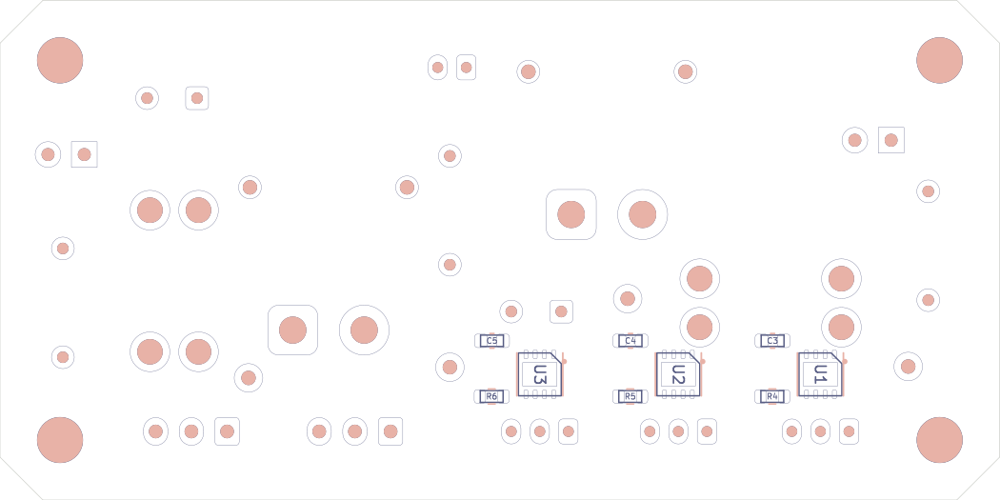

# B25 서보 허브 A4

받침 뒤의 **XT30은 5 V**, **XT60은 12 V**입니다. 내부 J2의 12 V 리드는 작업대에서 연결하고 고정합니다. 조립 후 정비할 때는 뒤쪽 XT60을 분리합니다. [3D 배선·정비](https://r5-b1-review.ckh.chatgpt.site/b25/wiring/) · [B25 조립](../mechanical/revisions/b25/assembly.md#전원-커넥터와-배선)

기판 발주는 A4 제작 파일과 아래 옵션을 사용합니다. 부품은 시험판을 맞춘 뒤 준비합니다. [A4 구매 규격](../mechanical/revisions/b25/03-order-after.md) · [검사 조건 14절](../spec/conditions.md#14-전원과-환경)

| 보드 | 제작 파일 | JLCPCB 발주 옵션 |
|---|---|---|
| [서보 허브 A4](servo-hub/R5_Servo_Hub.kicad_pro) | [Gerber·드릴·밑면 페이스트 ZIP](fabrication/R5_Servo_Hub_A4-Gerbers.zip) | 70 × 35 mm, **2층 FR-4 1.6 mm, 양면 완성 동박 2 oz**, ENIG, 녹색 솔더마스크 |

A4의 JST PH 11개 패드(J3–J6)는 **1.35 × 1.75 mm / Ø0.75 mm**입니다. J1과 J2의 XT30은 각각 **5.00 mm 피치, Ø1.90 mm 단자홀 2개, Ø1.00 mm 고정홀 2개**이며, 도금 고정홀의 동박 패드는 Ø1.60 mm입니다. J1 풋프린트 이름에 붙은 `P2.50mm`는 이전 이름입니다. 구매품은 두 곳 모두 5.00 mm 피치 XT30PW-M입니다. 전체 도금 부품홀 51개의 최소 설계 링은 0.300 mm로 JLCPCB의 2층 2 oz 기준 **0.254 mm**를 충족합니다. 비아 25개는 Ø0.70 또는 Ø0.90 mm 패드에 Ø0.35 mm 드릴을 사용합니다. KiCad 9.0.2에서 ERC, DRC, 미연결과 회로도 대조 각 0건입니다. [AMASS XT30PW-M 제조사 도면](https://www.tme.eu/Document/6eb2005a51a52592b3f19e8a450c54c8/XT30PW-M.pdf) · [JLCPCB 제작 한계](https://jlcpcb.com/capabilities/pcb-capabilities/)

### JLCPCB 밑면 실장

공장에는 밑면 SMD 9개만 맡깁니다. 받는 기판의 윗면에 C1·C2, D1·D2, F1·F2, J1–J8, R1–R3을 직접 납땜합니다. 직접 리플로우하는 경우는 별도의 밑면 스텐실을 사용합니다. [전체 허브 부품표](servo-hub/BOM.csv) · [밑면 스텐실](fabrication/R5_Servo_Hub_A4-Stencil.zip)

1. [A4 Gerber ZIP](fabrication/R5_Servo_Hub_A4-Gerbers.zip)을 기판 파일로 올리고 **밑면(Bottom)만 실장**하도록 선택합니다. ZIP에는 B.Paste가 들어 있습니다. 앞 표의 **양면 완성 동박 2 oz**와 ENIG를 유지하고, 선택한 실장 서비스가 70 × 35 mm 기판과 이 옵션을 지원하는지 견적에서 확인합니다. [JLCPCB 기판·실장 조건](https://jlcpcb.com/capabilities/pcb-assembly-capabilities)
2. BOM과 CPL 칸에 아래 전용 CSV를 각각 올립니다. **U1–U3, C3–C5, R4–R6 총 9개**가 모두 밑면에 매칭돼야 합니다. U1–U3은 TPS2557DRBR(C130056), C3–C5는 GRM188R71C104KA01D(C45000), R4–R6은 RT0603BRD0761K9L(C861498)입니다. 재고와 견적이 바뀔 수 있습니다. 저항을 대체한다면 **61.9 kΩ, 0.1%, 25 ppm/°C 이하, 0603**을 유지합니다. [업로드용 BOM](fabrication/R5_Servo_Hub_A4-JLCPCB-BOM.csv) · [업로드용 CPL](fabrication/R5_Servo_Hub_A4-JLCPCB-CPL.csv) · [JLCPCB 파일 형식](https://jlcpcb.com/help/article/How-to-generate-the-BOM-and-Centroid-file-from-KiCAD)
3. 배치 미리보기에서 세 TPS2557의 몸체 점이 **기판의 1번 패드 옆 실크 점**과 같은 쪽인지 확인합니다. 원래 Gerber X/Y 축에서는 1번 패드가 몸체 중심보다 **X −0.975 mm, Y +1.400 mm**에 있습니다. 같은 위쪽 모서리를 유지해 기판을 밑면에서 보면 각 몸체의 **오른쪽 위**입니다. 업로드 좌표는 KiCad의 mm 좌표와 각도를 그대로 변환했습니다. 공급사 라이브러리와 기준이 달라 보이면 미리보기에서 해당 부품 회전을 바로잡고 다시 확인합니다. [KiCad 원본 좌표](fabrication/R5-hub-back-positions-mm.csv) · [TI 1번 핀 도면](https://www.ti.com/lit/ds/symlink/tps2557.pdf)



## 전원과 배선

전원 계산에는 어댑터 공칭값 **5.0 V와 12 V**를 적용합니다. 동박 검토에 사용한 카탈로그 정지 전류는 XL330 5.0 V에서 1.47 A, XL430 12 V에서 1.40 A입니다. 전류 합은 5 V 분기 전 5.89 A, J1·F1 4.42 A(허브 10 mA 포함), J2·F2 2.80 A입니다. [XL330-M077 사양](https://emanual.robotis.com/docs/en/dxl/x/xl330-m077/#specifications) · [XL330-M288 사양](https://emanual.robotis.com/docs/en/dxl/x/xl330-m288/#specifications) · [XL430 사양](https://emanual.robotis.com/docs/en/dxl/x/xl430-w250/#specifications)

| 양극 경로 | 공통부 선폭과 전류 | 모터별 분기 선폭과 전류 |
|---|---|---|
| 5 V | 2.30–2.35 mm, 4.42 A | 제한기 앞 최소 0.32 mm, 뒤 최소 0.38 mm, 1.47 A |
| 12 V | 2.20–2.40 mm, 2.80 A | 1.25 mm, 1.40 A |

동박 두께 60 µm를 적용한 IPC-2221 외층 단일 트랙의 온도 상승 추정은 공통부에서 5 V 약 4 °C, 12 V 약 2 °C, 가장 좁은 5 V 분기에서 약 9 °C입니다. 5 V 분기의 Ø0.35 mm 비아는 JLCPCB의 평균 도금 두께 18 µm에서 약 1.6 mΩ 및 3.4 mW입니다. 위 전류에서 PCB 양극 동박의 전압 강하 추정은 J4–J6 **32.3–45.3 mV**, J7 **18.2 mV**, J8 **12.4 mV**입니다. GND는 양면 동박 면으로 연결됩니다. 정상 구동 중의 어댑터 출력과 모터 단자 최저 전압은 조립품에서 측정합니다. [동박 전압 강하 계산](power_check.py) · [KiCad 트랙 폭 계산 기준](https://docs.kicad.org/9.0/en/pcb_calculator/pcb_calculator.html#track-width) · [JLCPCB 비아 도금](https://jlcpcb.com/capabilities/pcb-capabilities/)

### 허브 단자와 배선

| 단자 | 연결 |
|---|---|
| J1 5 V 입력 | 패드 2는 +, 1은 GND. 기판 XT30PW-M에는 W3/W4의 XT30U-F가 연결 |
| J2 12 V 목 전원 입력 | 패드 2는 +, 1은 GND. 기판 XT30PW-M에는 W8/W9의 12 V XT30U-F가 연결. 작업대에서 결합해 잠금쇠로 고정하며 조립 상태의 정비 분리는 받침 뒤 XT60 |
| J3 OpenRB | W10은 OpenRB **EH 1(GND) → J3 PH 1**, W11은 **EH 3(DATA) → J3 PH 2**. OpenRB **EH 2(VDD)**는 단자 없이 비움 |
| J4–J6 | ID 1–3. PH 1 GND / 2 **개별 전류 제한 5 V** / 3 DATA |
| J7–J8 | ID 4·5. EH 1 GND / 2 **목 전원** / 3 DATA |
| ID 6 턱 | 어댑터 5 V에서 **2 A 인라인 퓨즈**를 거쳐 EH 2. 입력 GND는 EH 1, J6 DATA는 EH 3에 분기 |

5 V 배선에는 XT30U-F 두 개와 XT30U-M 한 개가 필요합니다. F 한 개는 5 V 전원 꼬리에, 다른 한 개는 허브 J1 쪽 W3/W4에 씁니다. OpenRB는 USB를 뽑은 상태에서 점퍼를 **USB(VIN)** 쪽에 놓습니다. OpenRB의 나사식 VIN 단자는 비워 두고 제어기만 USB로 공급합니다. 5 V와 목 전원은 GND·DATA를 공유하고 양극은 별도입니다. [OpenRB 전원 점퍼](https://emanual.robotis.com/docs/en/parts/controller/openrb-150/#power-source-jumper) · [포트 핀 배치](https://emanual.robotis.com/docs/en/parts/controller/openrb-150/#dynamixel-ports)

외부 5 V XT30과 12 V XT60은 간격이 각각 5.0 mm와 7.2 mm이며 반대편 외형에도 맞지 않습니다. 내부에서는 J1과 J2 모두 XT30을 쓰므로, 12 V J2 리드를 작업대에서 먼저 연결하고 H3·H4 잠금쇠로 고정합니다. 받침 뒤의 12 V 공급선과 같은 전압의 정비 접속부에는 각각 용도를 표시합니다. 전원은 +를 패드 2, GND를 패드 1에 연결합니다. [AMASS XT30U](https://www.china-amass.com/biao/268.html) · [AMASS XT60U](https://www.china-amass.com/biao/288.html) · [B25 조립과 배선](../mechanical/revisions/b25/assembly.md#전원-커넥터와-배선)

### 전원 실물 검수

**내부 XT30 오삽에 주의합니다.** J1과 J2는 같은 XT30PW-M입니다. J1에 12 V가 들어가면 모터를 빼 둔 상태에서도 TPS2557의 절대최대 7 V와 C1의 정격 10 V를 넘깁니다. F1은 과전류용이며 12 V 오삽을 막아 주지 않습니다. [TPS2557 데이터시트 7.1·7.3절](https://www.ti.com/lit/ds/symlink/tps2557.pdf)

1. **어댑터와 USB를 모두 빼고 모터·OpenRB를 허브에서 분리합니다.** F1·F2 퓨즈를 둘 다 뺍니다. W3/W4는 양쪽 끝에 `J1 · 5 V`, W8/W9는 `J2 · 12 V`라고 표시합니다. 뒤의 XT60 두 곳도 `12 V IN`과 `12 V SERVICE`로 구분합니다. 무전원에서 하네스의 양극·GND를 도통으로 추적합니다. 허브 플러그를 꽂기 전에 어댑터마다 실제 출력과 극성을 잽니다.
2. **퓨즈를 뺀 채** 검증한 플러그를 꽂습니다. TP3에 멀티미터 검정 리드를 두고, 어댑터를 한 개씩만 켭니다. 5 V는 **F1 입력 접점**, 12 V는 **F2 입력 접점**에 나타나야 합니다. 입력 접점은 무전원에서 해당 J1·J2 패드 2와 도통되는 쪽입니다. 반대 입력에 공급 전압이 나오거나 극성이 다르면 전원을 빼고 배선을 고칩니다.
3. 두 어댑터를 다시 빼고 **F1 7.5 A, F2 4 A**를 장착합니다. 모터와 USB를 뺀 상태에서 아래처럼 한 계통씩 확인한 뒤, 전원을 빼고 J2의 H3·H4 잠금쇠를 고정합니다. 일상 정비는 받침 뒤 XT60 서비스 접속부에서 합니다.

   | 연결할 어댑터 | TP3(GND) 기준 | 모터를 꽂기 전 출력 핀 2 |
   | --- | --- | --- |
   | 5 V만 | TP1 약 +5 V | J4–J6 약 +5 V, 2 A 인라인 퓨즈 뒤 턱 ID6 EH 약 +5 V |
   | 12 V만 | TP2 약 +12 V | J7·J8 약 +12 V |

4. **무전원에서** OpenRB 점퍼와 W10·W11의 도통을 확인합니다. EH 2에 금속 단자가 없는지 보고, W10/W11 사이에 단락이 없는지 확인한 뒤 J3를 연결합니다. 모터 커넥터도 전원을 뺀 상태에서 연결합니다. 보정 후 실제 구동 중 어댑터 출력과 모터 단자 최저 전압, 끊김 여부를 기록합니다. [P07 실물 시험](../spec/bench.md#b25-실물-시험)

## 재현

저장소 루트에서 KiCad 9의 `kicad-cli`와 `pcbnew`가 설치된 Python으로 실행합니다. 회로·PCB 검사와 BOM 대조 후 `build/electronics/servo-hub/`에 Gerber, 처리를 거친 업로드용 BOM·CPL, KiCad 원본 좌표와 스텐실을 생성합니다.

```sh
/usr/bin/python3 electronics/power_check.py --nominal
/usr/bin/python3 electronics/export.py servo-hub
```

## 이전 전장 검토 기록

이전 서보 허브 A3의 제작 파일입니다. [Gerber·드릴](fabrication/R5_Servo_Hub_A3-Gerbers.zip) · [스텐실](fabrication/R5_Servo_Hub_A3-Stencil.zip)

ESP32-C3 A1은 별도 RF 실험으로 보관합니다. B25의 부품·PCB 발주 범위에서 제외합니다. [C3 KiCad 원본](c3-rf/) · [이전 C3 제작·실장 기록](https://github.com/ckh7488/head/blob/9c024361d586ff5ea582cbac3e1328d40d5b0c65/electronics/README.md#c3-첫-동작)

### 외부 전원 보호 계산

이전 전원 설정과 외부 보호 시안은 개정 이력에서 확인할 수 있습니다. [이전 전원과 보호 계산](https://github.com/ckh7488/head/blob/9c024361d586ff5ea582cbac3e1328d40d5b0c65/electronics/README.md#외부-전원-보호-계산)
