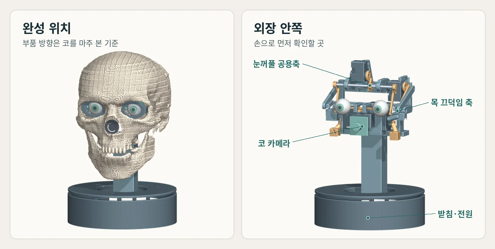
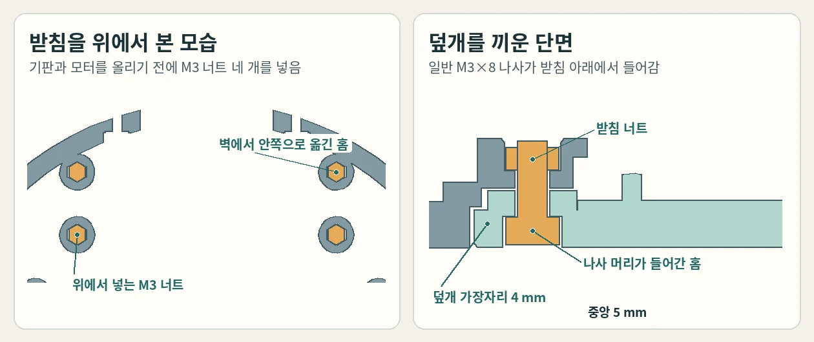
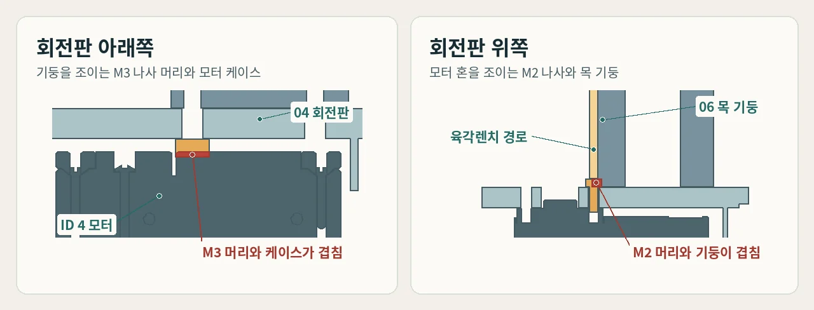
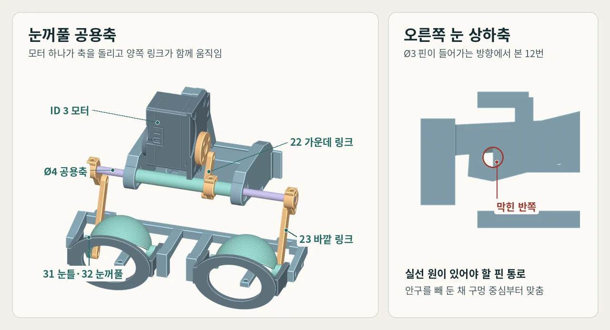
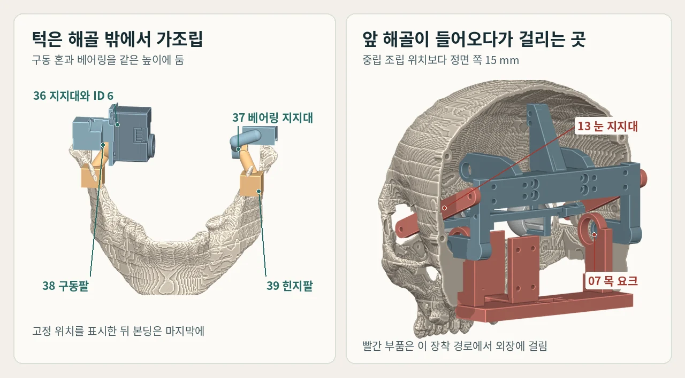

# R5 B9 조립절차서

부품을 움직이거나 간섭 위치를 확대할 때는 [3D 단계별 조립](https://r5-b1-review.ckh.chatgpt.site/b9/assembly/)을 엽니다.

**시험판 3번에서 받침과 덮개부터 맞춰 봅니다.** 받침, 목, 눈, 턱을 작업대에서 따로 맞춰 봅니다. 전체 출력과 외장 접착은 목 회전판 체결과 앞 해골 장착 문제가 해결된 뒤 진행합니다.

## 준비

- Bambu Studio에서 [시험판](R5-B9-Fit-P1S.3mf)을 프로젝트로 엽니다. 1번 판은 눈꺼풀과 레일, 2번 판은 케이블 고정, 3번 판은 덮개와 받침의 실제 체결부 시험용입니다. 본문의 `09` 같은 번호는 출력판 번호와 별개인 부품 이름 앞 번호입니다. 좌우는 코를 마주 보고 정합니다.
- 볼트 머리는 **육각렌치 원통머리 ISO 4762 (DIN 912)**로 고정합니다. M2는 1.5 mm, M3는 2.5 mm 육각렌치를 씁니다. 너트는 일반 육각형 DIN 934입니다. [기구 부품표](BOM.csv)
- 모터 본체와 혼에 들어가는 곳은 제조사 나사산과 실제 삽입 깊이를 대조해 체결품을 확정합니다. XL330은 성형 나사용 홀이고 XL430은 본체 M2.6 성형 나사, 혼 M2 탭을 씁니다. 원통머리와 공장 나사산을 함께 만족하는 체결품 확인까지 이 위치의 발주는 보류합니다. [XL330 사양](https://emanual.robotis.com/docs/en/dxl/x/xl330-m288/) · [XL430 사양](https://emanual.robotis.com/docs/en/dxl/x/xl430-w250/)
- 베어링 자리에 남은 서포트, 너트 홈과 핀 구멍의 돌기만 정리합니다. 너트와 핀을 한 개씩 먼저 끼워 보고, 가조립 중에는 접착과 나사고정제를 미룹니다.

## 1. 받침과 케이블 고정부

1. [시험판 3번](R5-B9-Fit-P1S.3mf)은 덮개 `35`와 받침 `01`의 체결부를 실제 크기로 담았습니다. 받침 아래쪽의 서포트를 떼고, 받침과 덮개에 일반 M3 너트를 **위에서** 네 개씩 넣습니다. 너트의 평평한 면을 홈과 맞추면 손으로 앉힐 수 있어야 합니다. 덮개 가장자리는 4 mm, 중앙은 5 mm입니다.
2. 허브 PCB를 덮개 안쪽 기둥에 올려 위에서 **M3×8 네 개**로 조입니다. 본체를 받쳐 세운 채 덮개를 아래에서 올리고 같은 **M3×8 네 개**로 붙입니다. 뒤집어서 조립할 때는 받침의 열린 너트 홈을 종이테이프로 덮어 둡니다. 바깥 나사 머리가 받침 밑면보다 0.35 mm 안쪽입니다. 작업대 위에서 흔들리는지 확인합니다. 받침과 덮개는 함께 맞춰 쓰며, [전체 출력판](R5-B9-P1S.3mf)에서 각각 1번과 11번 판입니다.
3. 케이블 트레이 `40` 아래 홈에 M3 너트 **5개**를 넣은 다음 받침 뒤에 트레이를 붙입니다. 트레이는 M3×16 두 개와 평와셔로, 위 덮개 `42`는 M3×16 다섯 개로 고정합니다. 커넥터 뒤턱을 받침에 밀착시키고 좌우·상하의 남는 틈은 얇은 시임으로 맞춥니다. [커넥터 치수](README.md#케이블-고정)
4. 받침에 캐리어 `27` 두 개와 목 좌우 모터(ID 4)의 브래킷 `05`를 놓습니다. C3를 넣는다면 캐리어 아래 M2 너트 두 개를 먼저 넣고 위에서 M2×8로 고정합니다. C3의 USB-C는 앞을 향합니다. 보드와 외부 커넥터를 가조립한 뒤 허브 덮개가 배선을 당기지 않고 아래로 **30 mm** 내려오는지 확인합니다. [배선과 전원](../electronics/README.md#전원과-배선)

**통과 기준** · 전원을 뺀 상태로 커넥터별로 직선과 45° 방향에서 각각 10 N을 30초 가합니다. 0.5 mm 넘게 움직이거나 피복에 자국이 남으면 커넥터 뒤턱과 시임부터 다시 봅니다.

## 2. 목

1. `02` 위에서 큰 6816 베어링을 앉히고 눌림판 `41` 세 개를 M3×8로 고정합니다. 회전판 `04`는 내륜 위에 올립니다. 상판 `03`은 요크를 달기 전에 위에서 씌웁니다. 회전판과 상판을 가조립해 회전판이 상판을 긁지 않고 위로 **0.25~0.65 mm** 움직이는지 봅니다.
2. **회전판과 기둥 결합은 여기서 보류합니다.** CAD에서 `04` 밑면의 기둥 고정용 일반 M3 나사 머리 세 개가 ID 4 모터와 겹칩니다. `06` 기둥을 올리면 회전판 중앙 뒤쪽의 M2 나사 머리와 육각렌치 공간도 가려집니다. 조립 순서를 바꿔도 나사 머리가 차지할 공간은 그대로입니다.
3. 끄덕임 모듈은 작업대에서 따로 시험합니다. `06` 옆 홈에 M3 너트 세 개를 넣고 위에서 M3×16 세 개로 요크 `07`을 체결합니다. 688 베어링은 양 끝 **바깥쪽**에서 넣습니다. 외장 없이 머리 프레임 `09`를 위에서 내려 놓고, 왼쪽 짧은 Ø8 축과 오른쪽 긴 Ø8 축을 각각 바깥쪽에서 끼웁니다. 오른쪽 축의 평평한 끝이 안쪽 `08` 구동 혼 쪽입니다. 두 축을 끼울 때 프레임을 손으로 받칩니다.

**통과 기준** · 구동 혼을 풀어 둔 상태로 프레임을 들고 숙입니다. 한쪽 핀을 넣으려고 요크를 벌려야 하거나, 축을 고정한 뒤 한쪽이 뻑뻑해지면 베어링 자리와 좌우 축 중심부터 확인합니다. 외장·턱·배선을 단 머리는 약 629 g으로 추정했습니다. 실제 무게와 중립에서의 쏠림을 재고 균형추를 결정합니다.

## 3. 눈과 눈꺼풀

시험판 1번만 출력했다면 **눈꺼풀 한 장씩**부터 시작합니다. 안구와 상하축 핀의 끼움을 확인할 때는 전체 출력판에서 `13` 지지대(7번 판)와 `14` 안구(10번 판)를 추가로 뽑습니다.

1. **안구** · 양쪽 눈 `14`를 크래들 `12`에 놓고 위에서 Ø2×24 핀을 넣습니다. `13` 양쪽 지지대와 `12` 사이에는 Ø3×17 핀을 바깥에서 넣습니다. **오른쪽 `12`에는 보강재가 핀 구멍 반쪽을 막습니다.** 이미 출력했다면 안구를 빼고 `13`과 `12`의 축 중심을 맞춘 상태에서 Ø3.2 mm 손드릴로 막힌 쪽을 뚫습니다. 핀이 손으로 통과하고 크래들이 돌아가는지 확인한 뒤 링크 `15`와 `18`을 답니다.
2. **눈꺼풀 한 장씩** · `31` 눈틀에 `32` 눈꺼풀을 대고 안쪽과 바깥쪽에서 Ø2×9.5 핀을 하나씩 넣습니다. 핀은 고정 눈틀에 잡히고 눈꺼풀만 핀 위에서 돌아야 합니다. 본딩할 때는 고정 눈틀 쪽에만 접착제를 씁니다. 링크 없이 양쪽이 각각 가볍게 열리고 닫히는지 봅니다.
3. **공용축** · 레일 `24`의 MR104ZZ 두 개는 가운데에서 양 바깥쪽으로 눌러 앉힙니다. 간격통 `45`는 긴 것이 왼쪽이며 얇은 턱이 베어링 안쪽 링을 향합니다. 크랭크 `21` 세 개에 M2 너트를 옆으로 넣습니다. 간격통과 가운데 크랭크를 대고 Ø4×112 축을 옆에서 통과시킨 뒤 양끝 크랭크를 끼웁니다. 축의 가운데에서 **−53.90, +10.20, +54.15 mm**에 같은 방향으로 만든 깊이 0.45 mm 평면에 **M2×8** 나사를 맞춥니다. 기존 M2×4보다 머리가 4 mm 올라간 조건으로 깜빡임 구간의 주변 간섭을 확인했습니다.
4. **링크와 모터** · 레일 앞쪽에 M3 너트 네 개를 넣고 프레임 뒤에서 M3×20으로 체결합니다. 모터 장착판에도 M3×20 두 개를 씁니다. 모터 혼 뒤에 M2 너트를 넣은 뒤 가운데 링크의 혼 쪽에 M2×6을 끼웁니다. 나머지 관절은 M2×8 다섯 개입니다. 평와셔를 대고 링크가 좌우로 **0.10~0.20 mm** 움직일 여유를 둡니다. 조립이 끝난 뒤 금속 나사산에만 낮은 강도의 나사고정제를 소량 씁니다.

**통과 기준** · 시험판에서는 양쪽 눈틀이 들리지 않게 받쳐 두고, 가운데 링크를 모터에서 풀어 손으로 공용축을 돌립니다. 좌우가 같은 시점에 닫히고 관절 나사를 조인 뒤에도 움직임이 가벼워야 합니다. 뻑뻑하면 **눈꺼풀 단독 → 공용축 단독 → 왼쪽 링크 → 오른쪽 링크** 순서로 하나씩 연결해 원인을 찾습니다. 외장이 있는 실물의 눈과 눈꺼풀 간격은 마지막에 다시 확인합니다.

## 4. 턱과 코 카메라

1. 해골 밖에서 왼쪽 지지대 `36`에 ID 6을 달고 구동팔 `38`을 준비합니다. 오른쪽 지지대 `37`에는 MR104ZZ를 넣고 Ø4×10 핀과 힌지팔 `39`를 맞춥니다. `38`의 혼 중심 나사에 렌치가 들어가는 자세를 확보하고, 양쪽 지지대가 삐뚤어지지 않게 턱 `30`과 함께 가조립합니다.
2. 구동을 분리하고 턱을 받친 상태로 닫힘에서 최대 13°까지 움직입니다. 치아 사이에 얇은 종이가 끼거나 한쪽만 밀려 올라가면 양쪽 지지대의 높이를 다시 맞춥니다. 턱과 양쪽 팔의 접착 위치는 표시해 두고, 본딩은 외장 장착을 확인한 뒤 합니다.
3. 카메라는 렌즈가 앞으로 나오게 브래킷 `26`에 대고 M2와 넓은 평와셔로 잡습니다. 코 트레이 `25`와 코 테두리 `33`을 앞 해골에 임시로 고정해 USB 화면을 먼저 띄웁니다. 렌즈는 코 표면에서 약 2 mm 뒤가 시작점입니다. 화면 테두리에 코가 찍히거나 케이블을 움직일 때 영상이 끊기면 위치를 다시 잡습니다.

## 5. 외장과 첫 구동

| 확인할 곳 | 가조립 판정 |
|---|---|
| 앞 해골 `28` | 눈 지지대 `13`과 목 요크 `07`을 단 상태에서 정면으로 밀어 넣으면 걸립니다. 앞 해골을 먼저 붙이면 Ø8 목 축이 옆에서 들어오는 길을 막습니다. 조립 경로와 공구 접근을 확보하기 전까지 외장 탭 `10`은 접착하지 않습니다. |
| 검은 눈틀 `31` | 눈틀만 정면에서 직선으로 넣어도 걸립니다. 눈틀이 들어가고 핀을 다시 뺄 수 있는 경로를 확보한 뒤 고정합니다. |
| 뒤 해골 `29` | 오른쪽 외장 탭 `10`이 닫히기 직전 겹칩니다. Ø3 맞춤 핀을 누르기 전에 탭 자리와 이음면이 힘 없이 맞는지 봅니다. 눈 지지대 `13`의 옆 나사는 뒤 해골을 닫기 전에 조입니다. |

외장과 구동 체결이 위 확인을 통과하면 몸체를 받치고 전원을 연결합니다. 모터를 뺀 채 **5 V**와 **11.1~12.0 V**를 각각 확인한 뒤, 모터 ID를 하나씩 맞춥니다. 외장을 열고 각 축을 작은 범위에서 저속으로 확인한 다음 실물 끝 위치를 보정합니다. 마지막으로 외장을 임시로 씌워 닫기 전과 비교합니다. [전원 측정과 핀 배치](../electronics/README.md#전원과-배선) · [축별 ID와 보정](../control/README.md#openrb와-모터)

- **렌치로 조인 뒤 뻑뻑함** · 링크의 평와셔와 축방향 유격, 두 베어링의 축을 확인합니다.
- **외장을 얹은 뒤 긁힘** · 눈꺼풀 끝, 오른쪽 눈 링크, 턱 뒤쪽에 종이 조각을 대고 닿은 위치를 찾습니다.
- **목 끝 자세에서만 소리 또는 끊김** · 목을 받치고 전원을 뺀 뒤 배선이 베어링이나 상판에 끼거나 당겨지는지 확인합니다.

지금까지의 조립 경로와 공구 접근은 [B9 FreeCAD 모델](R5-B9-Assembly.FCStd)에서 확인했습니다. 출력 공차, 접착면의 강도, 작동 소음은 실물 가조립에서 확인해야 합니다.
